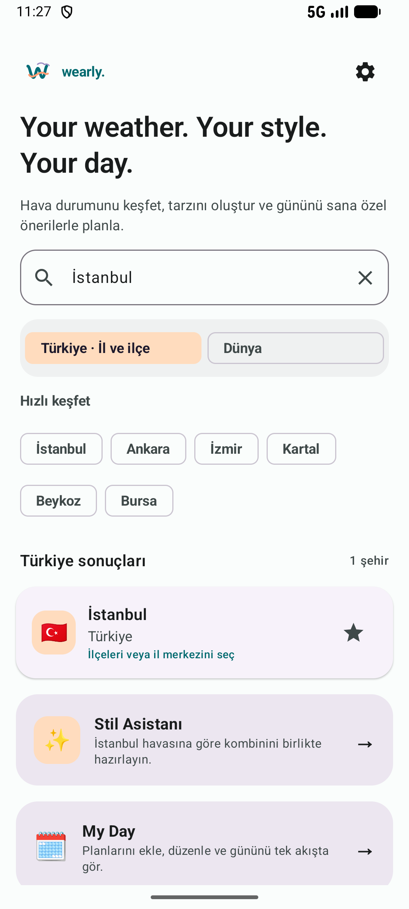
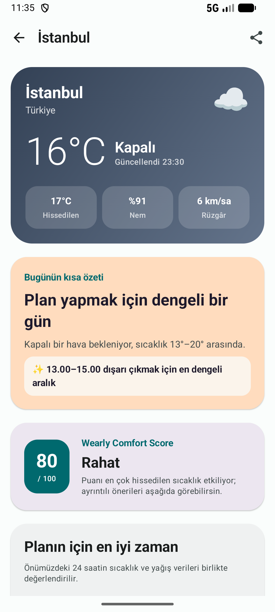
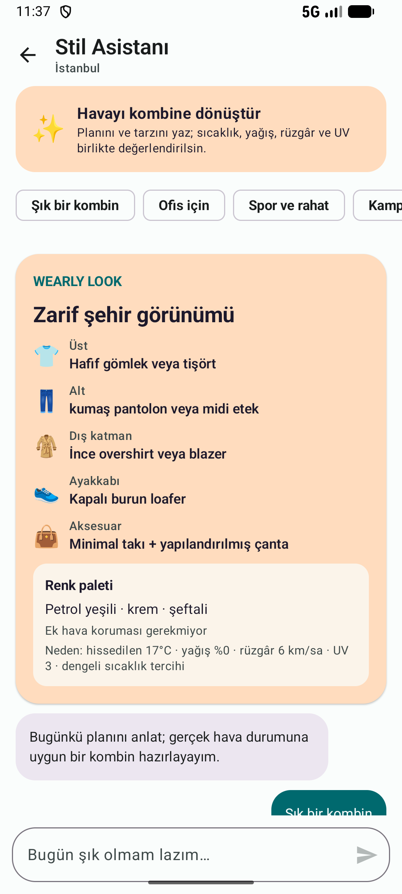
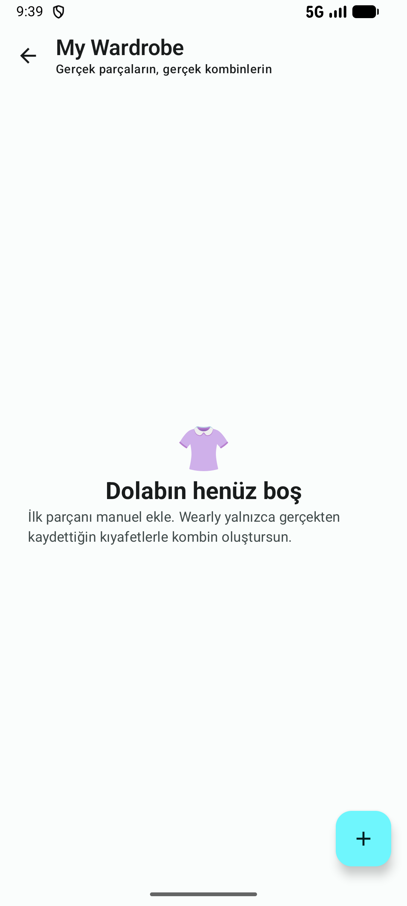
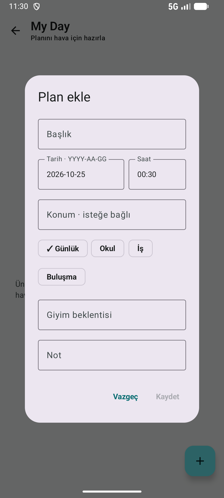
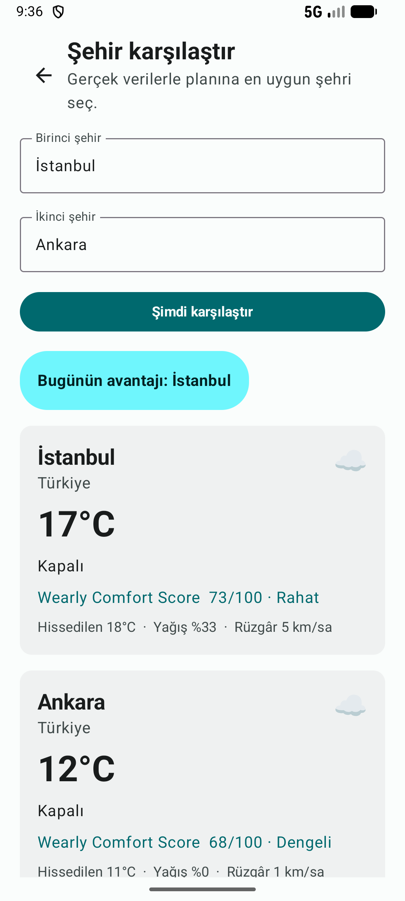
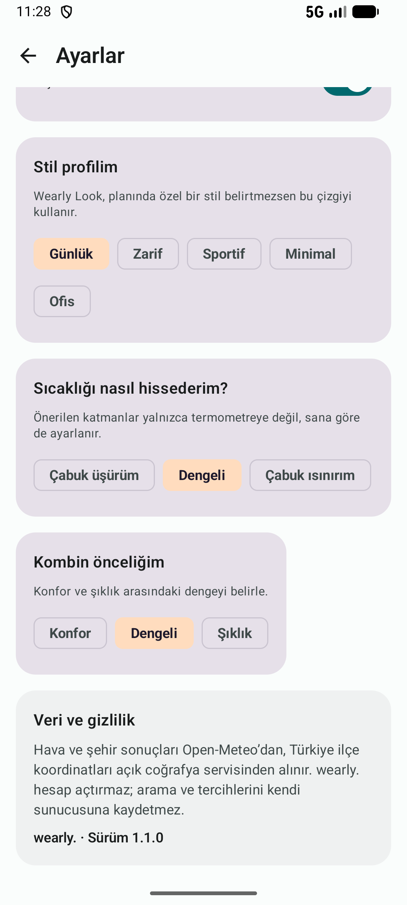

<div align="center">
  

  # wearly.
  ### Your weather. Your style. Your day.

  Gerçek hava verisini kişisel stil ve günlük planlarla birleştiren modern yaşam asistanı.

  
  
  
  
  
</div>

---

## One app. Three connected decisions.

| Weather | Style | Your Day |
| :---: | :---: | :---: |
| Dünya genelinde gerçek tahmin, 81 il ve ilçeler | Hava, tercih ve gardıroba göre Wearly Look | Plan, en iyi saat ve Android takvim akışı |

Wearly yalnızca sıcaklığı göstermez. **Ne zaman çıkmalıyım? Ne giymeliyim? Günümü nasıl planlamalıyım?** sorularını tek deneyimde yanıtlar.

## Product experience

<table>
  <tr>
    <td align="center" width="33%"><br/><sub><b>Home</b> · global discovery</sub></td>
    <td align="center" width="33%"><br/><sub><b>Weather</b> · forecast & Comfort Score</sub></td>
    <td align="center" width="33%"><br/><sub><b>Wearly Look + Assistant</b></sub></td>
  </tr>
  <tr>
    <td align="center"><br/><sub><b>My Wardrobe</b> · real pieces</sub></td>
    <td align="center"><br/><sub><b>My Day</b> · plans & calendar</sub></td>
    <td align="center"><br/><sub><b>Compare</b> · live city data</sub></td>
  </tr>
</table>

<details>
  <summary><b>Personalization settings</b></summary><br/>
  <p align="center"></p>
</details>

## Why Wearly?

- **Real global weather:** Open-Meteo ile dünya şehirleri; Türkiye'nin 81 ili ve ilçeleri.
- **Wearly Comfort Score:** Sıcaklık, yağış, rüzgâr, nem ve UV'den açıklanabilir 0–100 puan.
- **Best time:** Saatlik tahminden yürüyüş, spor, kahve veya yolculuk için en dengeli aralık.
- **Wearly Look:** Plan, stil, sıcaklık hassasiyeti ve şıklık/konfor önceliğinden kişisel kombin.
- **My Wardrobe:** Kıyafet yönetimi ve galeriden kalıcı fotoğraf; öneriler kayıtlı parçalara sadık kalır.
- **My Day:** Konum ve giyim beklentili planlar; Android Calendar Intent ile takvime aktarım.
- **Personal by default:** Onboarding, favoriler, °C/°F, açık/koyu/sistem teması.
- **Actionable protection:** Yağmur, katman, rüzgâr ve UV seviyesine göre SPF önerileri.

> Wearly Look; gerçek tahmin, kullanıcı tercihleri ve gardırop verisiyle çalışan deterministik ve test edilebilir bir öneri motorudur. Gizli API anahtarı veya uydurulmuş gardırop verisi kullanmaz.

## Technology & architecture

| Layer | Technology |
| --- | --- |
| UI | Kotlin, Jetpack Compose, Material 3 |
| State | ViewModel, StateFlow, Coroutines |
| Data | Repository, Retrofit, Gson, Open-Meteo |
| Local | SharedPreferences, app-private photo storage |
| Quality | JUnit, MockWebServer, Spotless, Android Lint |

```text
Compose UI → ViewModel + StateFlow → Repository → Retrofit → Open-Meteo
                         ↘ preferences, plans, wardrobe and photos
```

Detaylar: [`docs/ARCHITECTURE.md`](docs/ARCHITECTURE.md)

## Installation

Gereksinimler: Android Studio, Android SDK 36, JDK 17 veya 21.

```bash
git clone https://github.com/serratanis/wearly.git
cd wearly
```

`local.properties`:

```properties
sdk.dir=/your/local/Android/sdk
```

```bash
./gradlew assembleDebug
./gradlew testDebugUnitTest
./gradlew lintDebug
./gradlew spotlessCheck
```

Debug APK: `app/build/outputs/apk/debug/app-debug.apk`

## 90-second demo

1. İstanbul veya Kartal ile gerçek tahmini aç.
2. Comfort Score ve planın için en iyi zamanı göster.
3. Wearly Look'a “Bugün şık olmam lazım” diye sor.
4. My Wardrobe'a fotoğraflı bir parça ekle.
5. My Day planını Android takvimine aktar.
6. İstanbul ve Ankara'yı canlı verilerle karşılaştır.

## Quality & privacy

- **47 unit tests**: API eşleme, repository, ViewModel, öneri, Comfort Score ve Wearly Look.
- Loading, empty, error ve retry durumları; TalkBack açıklamaları.
- API anahtarı ve hesap gerekmez.
- Tercihler, planlar, sohbetler, gardırop ve fotoğraflar cihazda tutulur.

---

<div align="center">
  <b>Built for Turkcell Bilişim Kampı</b><br/>
  <sub>Weather that understands your style and your day.</sub>
</div>
